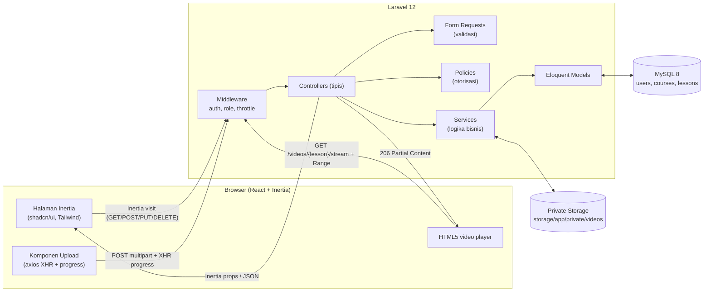
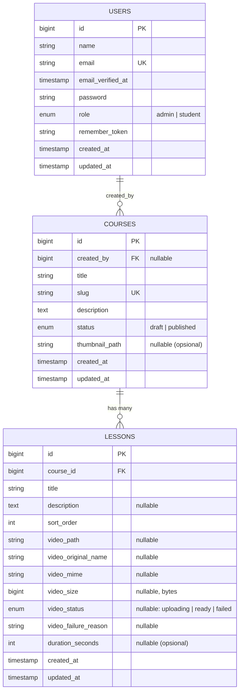
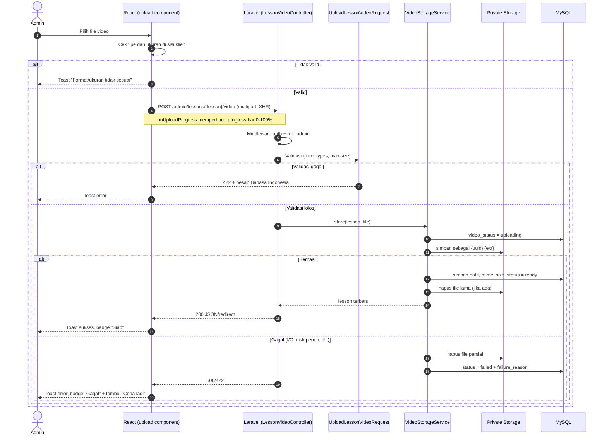
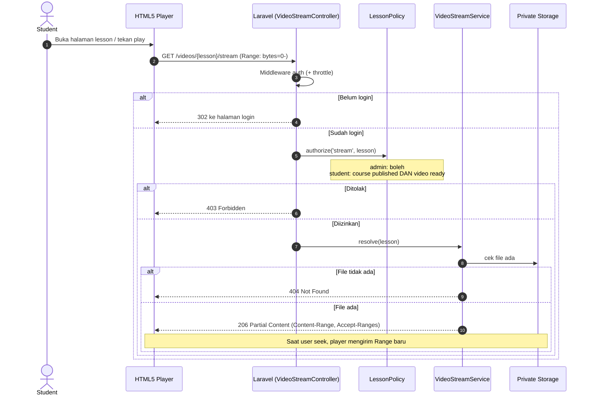

# Simple E-Learning Platform: System Design

Dokumen ini memuat rancangan sistem sebelum implementasi, disertai catatan perbedaan pada implementasi final (bagian 10). Identifier teknis (tabel, kolom, class, route) memakai Bahasa Inggris; teks antarmuka memakai Bahasa Indonesia.

---

## 1. Keputusan Teknis

| Area | Keputusan | Alasan |
|---|---|---|
| Backend | Laravel 12, PHP 8.2+, MySQL 8 | Diwajibkan brief |
| Frontend | Inertia 2 + React + TypeScript (Laravel Breeze) | Tanpa API terpisah; routing, auth, dan CSRF ditangani Laravel; tipe data aman di UI |
| UI | Tailwind CSS 3.4 + komponen sendiri berbasis token tema (CSS variables) | Breeze tidak membawa shadcn/ui; komponen ringan dan konsisten dengan token tema |
| Storage video | Disk `local` (`storage/app/private/videos`) | Tidak dapat diakses lewat URL; wajib melalui endpoint ber-otorisasi |
| Streaming | `response()->file()` (`BinaryFileResponse`) | Mendukung HTTP Range (206) secara bawaan |
| Upload | XHR dengan progress ke endpoint khusus | Progress bar real-time tanpa Queue, Redis, atau FFmpeg |
| Arsitektur kode | Controller tipis, Service, Form Request, Policy, Enum | Logika bisnis terpisah, mudah diuji |
| Pengurutan lesson | Endpoint reorder (array id berurutan) | Satu endpoint melayani tombol naik/turun maupun drag-and-drop |

> `Storage::response()` memakai `StreamedResponse` yang tidak menangani header `Range`, sehingga streaming memakai `response()->file($absolutePath)`.

---

## 2. Arsitektur Sistem



Prinsip:
1. Browser tidak pernah menerima URL file video, hanya URL endpoint stream.
2. Setiap request melewati `auth`, middleware `role` (area admin), Form Request (validasi), dan Policy (otorisasi) sebelum Service bekerja.
3. Database menyimpan metadata dan path relatif; file video hanya ada di private storage.

---

## 3. Desain Database

### 3.1 ERD



### 3.2 Spesifikasi Tabel

**`users`** (tabel bawaan starter kit + kolom `role`)

| Kolom | Tipe | Catatan |
|---|---|---|
| id | BIGINT UNSIGNED PK | |
| name | VARCHAR(255) | |
| email | VARCHAR(255) | UNIQUE |
| email_verified_at | TIMESTAMP NULL | |
| password | VARCHAR(255) | Hash bcrypt |
| role | ENUM('admin','student') | Default `student`; INDEX `users_role_index` |
| remember_token | VARCHAR(100) NULL | |
| created_at, updated_at | TIMESTAMP NULL | |

`role` tidak boleh masuk `$fillable` dari input publik. Registrasi selalu membuat `student`; admin dibuat melalui seeder.

**`courses`**

| Kolom | Tipe | Catatan |
|---|---|---|
| id | BIGINT UNSIGNED PK | |
| created_by | BIGINT UNSIGNED NULL | FK → `users.id`, `ON DELETE SET NULL` |
| title | VARCHAR(255) | |
| slug | VARCHAR(255) | UNIQUE; untuk URL yang rapi |
| description | TEXT | |
| status | ENUM('draft','published') | Default `draft`; INDEX `courses_status_index` |
| thumbnail_path | VARCHAR(255) NULL | Opsional, di luar MVP |
| created_at, updated_at | TIMESTAMP NULL | |

**`lessons`**

| Kolom | Tipe | Catatan |
|---|---|---|
| id | BIGINT UNSIGNED PK | |
| course_id | BIGINT UNSIGNED | FK → `courses.id`, `ON DELETE CASCADE` |
| title | VARCHAR(255) | |
| description | TEXT NULL | |
| sort_order | UNSIGNED INT | Urutan dalam course (mulai dari 1) |
| video_path | VARCHAR(255) NULL | Path relatif, mis. `videos/{uuid}.mp4` |
| video_original_name | VARCHAR(255) NULL | Hanya untuk tampilan; tidak dipakai sebagai nama file |
| video_mime | VARCHAR(100) NULL | Hasil deteksi server |
| video_size | UNSIGNED BIGINT NULL | Dalam byte |
| video_status | ENUM('uploading','ready','failed') NULL | NULL = belum ada video |
| video_failure_reason | VARCHAR(255) NULL | Pesan singkat saat `failed` |
| duration_seconds | UNSIGNED INT NULL | Opsional |
| created_at, updated_at | TIMESTAMP NULL | |

Indeks: `INDEX lessons_course_sort_index (course_id, sort_order)`. Indeks ini sengaja tidak UNIQUE agar proses reorder (tukar posisi) tidak bentrok di tengah transaksi.

Tabel standar Laravel (`sessions`, `cache`, `password_reset_tokens`, `migrations`) mengikuti bawaan framework.

### 3.3 Aturan Data

- **Hapus course:** lesson ikut terhapus (cascade di DB). `CourseService::delete()` membersihkan file video **sebelum** record dihapus.
- **Hapus lesson:** `LessonService::delete()` menghapus file video, lalu merapikan ulang `sort_order` lesson lain.
- **Ganti video:** file baru disimpan lebih dulu; file lama dihapus hanya setelah file baru tersimpan dan DB diperbarui.
- **Lesson baru:** `sort_order = MAX(sort_order) + 1` dalam course terkait.

### 3.4 Enum PHP

`UserRole` (`Admin`, `Student`), `CourseStatus` (`Draft`, `Published`), dan `VideoStatus` (`Uploading`, `Ready`, `Failed`), seluruhnya di `App\Enums`. Semua berupa backed enum string dan di-cast di model.

---

## 4. Alur Kritis

### 4.1 Upload Video (Admin)



Upload berjalan dalam satu request tanpa Queue, sehingga status `uploading` hanya bersifat sementara di sisi server. Jika koneksi browser terputus saat transfer, controller tidak dijalankan dan status lama dipertahankan (lihat bagian 9).

### 4.2 Streaming Video (Student)



---

## 5. Route dan Otorisasi

| Method | URI | Controller@action | Akses |
|---|---|---|---|
| GET | `/dashboard` | `DashboardRedirectController` | auth; redirect sesuai role |
| GET | `/admin/courses` | `Admin\CourseController@index` | admin |
| GET | `/admin/courses/create` | `Admin\CourseController@create` | admin |
| POST | `/admin/courses` | `Admin\CourseController@store` | admin |
| GET | `/admin/courses/{course}/edit` | `Admin\CourseController@edit` | admin (memuat manajer lesson) |
| PUT | `/admin/courses/{course}` | `Admin\CourseController@update` | admin |
| DELETE | `/admin/courses/{course}` | `Admin\CourseController@destroy` | admin |
| POST | `/admin/courses/{course}/lessons` | `Admin\LessonController@store` | admin |
| PUT | `/admin/lessons/{lesson}` | `Admin\LessonController@update` | admin |
| DELETE | `/admin/lessons/{lesson}` | `Admin\LessonController@destroy` | admin |
| PATCH | `/admin/courses/{course}/lessons/reorder` | `Admin\LessonOrderController@update` | admin; body: `ordered_ids[]` |
| POST | `/admin/lessons/{lesson}/video` | `Admin\LessonVideoController@store` | admin; multipart |
| DELETE | `/admin/lessons/{lesson}/video` | `Admin\LessonVideoController@destroy` | admin |
| GET | `/courses` | `Student\CourseController@index` | student; hanya `published` |
| GET | `/courses/{course:slug}` | `Student\CourseController@show` | student; hanya `published` |
| GET | `/courses/{course:slug}/lessons/{lesson}` | `Student\LessonController@show` | student; halaman pemutar video |
| GET | `/videos/{lesson}/stream` | `VideoStreamController` | admin, atau student (published + ready) |

**Policy**
- `CoursePolicy`: `viewAny`; `view` (student hanya `published`); `create`, `update`, `delete` (admin).
- `LessonPolicy`: `stream` dan `view` (admin selalu boleh; student jika `course.status = published` dan `video_status = ready`); `manage` (admin).
- Route admin dilindungi middleware `role:admin` (`EnsureUserHasRole`) dan Policy sebagai lapisan kedua (defense in depth).

---

## 6. Struktur Direktori

### 6.1 Backend

```
app/
├── Enums/                  UserRole, CourseStatus, VideoStatus
├── Http/
│   ├── Controllers/
│   │   ├── DashboardRedirectController.php
│   │   ├── VideoStreamController.php
│   │   ├── Admin/          CourseController, LessonController,
│   │   │                   LessonOrderController, LessonVideoController
│   │   └── Student/        CourseController, LessonController
│   ├── Middleware/         EnsureUserHasRole
│   ├── Requests/Admin/     StoreCourse, UpdateCourse, StoreLesson, UpdateLesson,
│   │                       ReorderLessons, UploadLessonVideo
│   └── Resources/          CourseResource, LessonResource
├── Models/                 User, Course, Lesson
├── Policies/               CoursePolicy, LessonPolicy
└── Services/
    ├── CourseService           # CRUD course (+ bersihkan video)
    ├── LessonService           # CRUD lesson, hitung sort_order
    ├── LessonOrderingService   # reorder dalam satu transaksi
    ├── VideoStorageService     # simpan/ganti/hapus file, transisi status
    └── VideoStreamService      # resolve path aman, bangun response Range

config/video.php            # disk, direktori, MIME yang diizinkan, ukuran maksimum
database/                   # migrations, factories (Course, Lesson), seeders (User, Course)
routes/web.php              # grup admin (role:admin) dan student
tests/Feature/              RoleRedirect, CourseCrud, LessonOrder,
                            LessonVideoUpload, VideoStreamAuthorization
```

### 6.2 Frontend

```
resources/
├── css/app.css                      # token tema (bagian 7)
└── js/
    ├── app.tsx                      # entry Inertia (+ Toaster)
    ├── pages/
    │   ├── auth/                    # login, register (bawaan starter kit)
    │   ├── admin/courses/           # index, create, edit (form course + manajer lesson)
    │   └── student/
    │       ├── courses/             # index (katalog), show (detail + daftar lesson)
    │       └── lessons/show.tsx     # pemutar video + sidebar lesson
    ├── layouts/                     # app-layout, auth-layout
    ├── components/
    │   ├── ui/                      # button, card, dialog, alert, skeleton, progress, ...
    │   ├── courses/                 # course-card, course-form, course-status-badge
    │   ├── lessons/                 # lesson-list, lesson-form-dialog,
    │   │                            # lesson-sortable-list, lesson-sidebar
    │   ├── video/                   # video-player, video-upload-field, video-status-badge
    │   └── shared/                  # confirm-delete-dialog, empty-state, page-skeleton
    ├── hooks/                       # use-appearance, use-video-upload
    ├── lib/                         # utils (cn), format (ukuran file, durasi)
    └── types/                       # index.d.ts, models.ts
```

---

## 7. Tema

Tema memakai palet kuning–oranye dengan token CSS variables. Implementasi final memakai **Tailwind 3.4**: variabel warna (`:root` dan `.dark`) berada di `resources/css/app.css` dan dipetakan ke nama kelas melalui `theme.extend.colors` di `tailwind.config.js` (`darkMode: 'class'`).

| Token | Terang | Gelap | Peran |
|---|---|---|---|
| `--background` | `#ffffff` | `#09090b` | Latar halaman |
| `--foreground` | `#0f172a` | `#fafafa` | Teks utama |
| `--card` | `#ffffff` | `#121215` | Latar kartu |
| `--primary` | `#f59e0b` | `#facc15` | Aksi utama, status aktif |
| `--primary-foreground` | `#0f172a` | `#09090b` | Teks di atas `primary` |
| `--secondary` | `#fff7ed` | `#1f1a14` | Latar sekunder |
| `--muted` / `--muted-foreground` | `#f4f4f5` / `#52525b` | `#18181b` / `#a1a1aa` | Elemen redup |
| `--accent` / `--accent-foreground` | `#fef3c7` / `#78350f` | `#2a2108` / `#fde68a` | Hover, item aktif |
| `--destructive` | `#dc2626` | `#ef4444` | Aksi berbahaya |
| `--success` | `#16a34a` | `#22c55e` | Status berhasil |
| `--border` / `--input` | `#e4e4e7` | `#27272a` | Garis dan input |
| `--ring` | `#f59e0b` | `#facc15` | Fokus |
| `--brand-orange` | `#ea580c` | `#f97316` | Aksen kedua (progress bar, indikator aktif) |

Radius dasar: `--radius: 0.625rem`. Token `--chart-*` dan `--sidebar-*` mengikuti nilai di atas. Progress bar upload memakai gradasi `primary` → `brand-orange` (`.bg-brand-gradient`).

**Aksesibilitas**
- Teks pada tombol kuning memakai warna gelap (`--primary-foreground`). Putih di atas `#f59e0b` hanya berkontras sekitar 2:1.
- Oranye dipakai terutama untuk elemen non-teks. Untuk latar teks, gunakan varian yang lebih gelap.
- Pengalih tema memakai hook `use-appearance` bawaan starter kit (terang/gelap/sistem, tersimpan di `localStorage`).

---

## 8. Keamanan

| Risiko | Mitigasi |
|---|---|
| Akses video tanpa login | Video di private disk; satu-satunya akses melalui `/videos/{lesson}/stream` dengan `auth` |
| Student membuka video course draft | `LessonPolicy::stream` mensyaratkan `course.status = published` dan `video_status = ready` |
| Eskalasi role | `role` tidak ada di `$fillable`; registrasi selalu `student`; area admin dijaga middleware dan Policy |
| File berbahaya disamarkan sebagai video | Validasi `mimetypes:video/mp4,video/webm` berdasarkan isi file; ekstensi ditentukan server dari MIME hasil deteksi |
| Path traversal | Nama file berupa UUID buatan server; nama asli dari klien hanya disimpan sebagai teks tampilan |
| XSS | React meng-escape output; `video_original_name` ditampilkan sebagai teks biasa |
| CSRF | Bawaan Laravel/Inertia; upload XHR ikut mengirim token |
| SQL injection | Eloquent / query builder dengan parameter binding |
| Brute force login | Rate limiting bawaan |
| Penyalahgunaan endpoint stream | Middleware `throttle`; header `X-Content-Type-Options: nosniff` dan `Cache-Control: private` |
| Batas ukuran | `config/video.php` (`max_size_kb` dari `.env`), disinkronkan dengan `upload_max_filesize` dan `post_max_size` |

---

## 9. Asumsi dan Keterbatasan

**Asumsi**
- Satu course memiliki banyak lesson; satu lesson memiliki satu video.
- Admin dibuat melalui seeder; student dapat mendaftar mandiri dan melihat semua course `published` (tanpa enrollment).
- Format video: MP4 dan WebM, diputar langsung oleh browser tanpa transcoding.
- Ukuran maksimum video dapat dikonfigurasi (default 200 MB) dan memerlukan penyesuaian `php.ini`.

**Keterbatasan**
- Tanpa Queue, upload dan pemrosesan berjalan dalam satu request. Jika koneksi terputus saat transfer, status video lama dipertahankan.
- Tidak ada transcoding, HLS, atau adaptive bitrate; kompatibilitas bergantung pada file asli.
- Belum ada enrollment, progres belajar, dan sertifikat (di luar lingkup wajib).
- `duration_seconds` dan `thumbnail_path` bersifat opsional dan tidak termasuk MVP.
- Penyimpanan lokal sesuai untuk demo. Untuk produksi, disk dapat diganti ke object storage (S3) tanpa mengubah Service karena memakai abstraksi `Storage`.

---

## 10. Perbedaan Implementasi dari Rancangan Awal

| Rancangan awal | Implementasi final | Alasan |
|---|---|---|
| `laravel new --react`, shadcn/ui, Tailwind v4 | Laravel Breeze (React, TypeScript), Tailwind 3.4, tanpa shadcn/ui | Pilihan starter kit; shadcn pada Tailwind 3 menambah kompleksitas setup, sehingga komponen dibuat sendiri dengan token tema yang sama |
| Direktori huruf kecil (`pages`, `components`) | `Pages`, `Components`, `Layouts` | Konvensi Breeze; nama harus sama persis dengan `Inertia::render()` agar berjalan di server Linux |
| Upload dengan axios manual | `router.post` Inertia dengan `forceFormData` dan `onProgress` | Tetap XHR; otomatis membawa CSRF, flash message, dan error validasi; mendukung pembatalan lewat cancel token |
| Resource lesson mengirim data video lengkap | Path file tidak dikirim; hanya `has_video`, status, nama asli, dan ukuran. Student memakai `StudentLessonResource` yang lebih sempit | Lokasi penyimpanan internal tidak perlu diketahui klien |
| Route student `/courses/{course}/lessons/{lesson}` | Route `courses.lessons.show` dengan `scopeBindings()` dan binding course melalui `slug` | Lesson milik course lain menghasilkan 404; URL lebih rapi |
| Seeder tanpa video | Seeder memasang video contoh jika `database/seeders/sample/sample.mp4` ada | Demo dapat langsung diputar setelah `migrate --seed` |
| Pesan validasi dan UI berbahasa Inggris | Locale `id`, `lang/id`, halaman Breeze dan halaman error diterjemahkan | Seluruh teks antarmuka wajib Bahasa Indonesia |

Tambahan di luar rancangan awal: `FlashToaster` (toast dari flash message Laravel), rate limiter `video-stream`, dan penanganan respons 413 (file melebihi `post_max_size`) di sisi klien.

---

## 11. Rencana Implementasi (Arsip)

1. Inisialisasi proyek, konfigurasi MySQL di `.env`, dan terapkan tema.
2. Migration, Enum, Model, Factory, dan Seeder (admin, student demo, course contoh).
3. Middleware `role`, redirect setelah login, dan test dasar role.
4. CRUD course (Form Request, Policy, Service, halaman admin).
5. CRUD lesson dan endpoint reorder (Service + transaksi).
6. Upload video (Service, validasi, hook `use-video-upload`, progress bar).
7. Endpoint streaming ber-Policy dengan Range, lalu area student (katalog, detail, pemutar).
8. Penyempurnaan: skeleton, empty state, toast, responsif, README, dan daftar keterbatasan.
